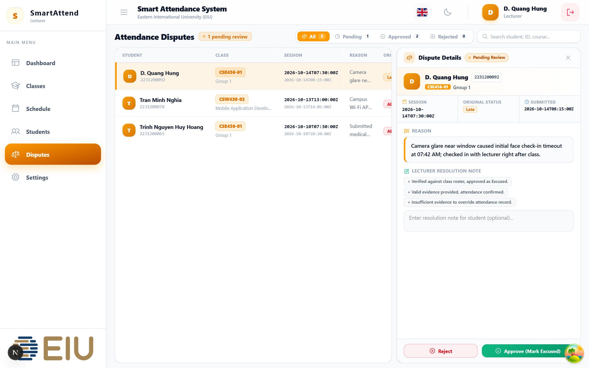
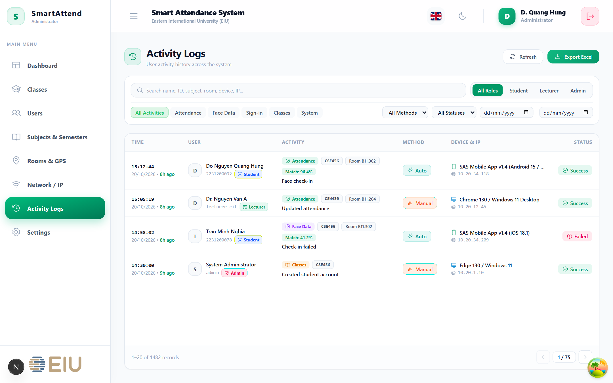
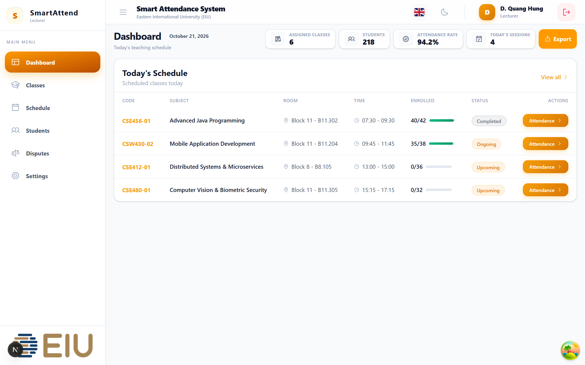
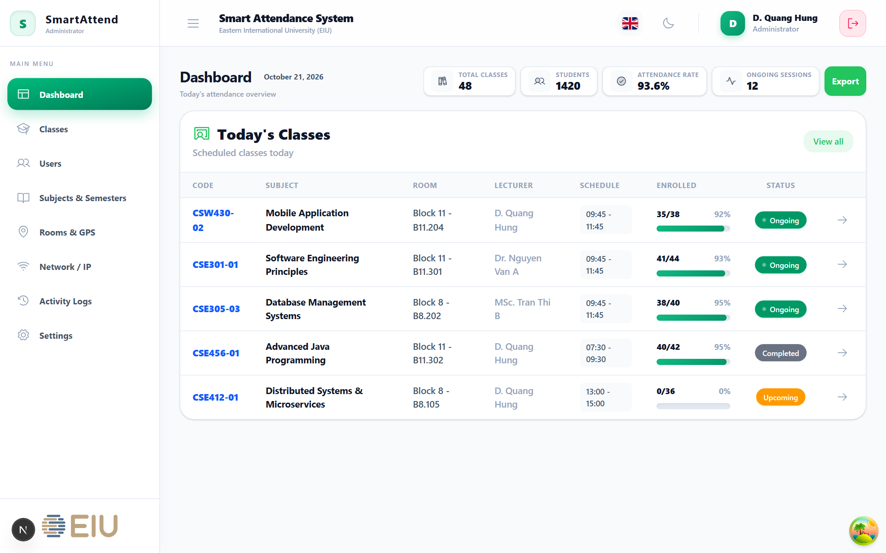
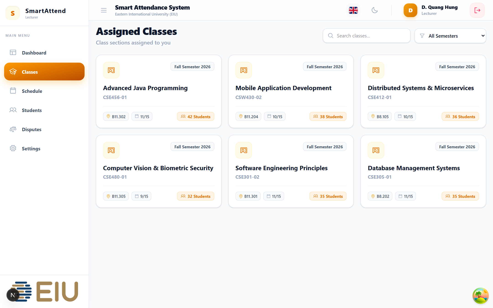
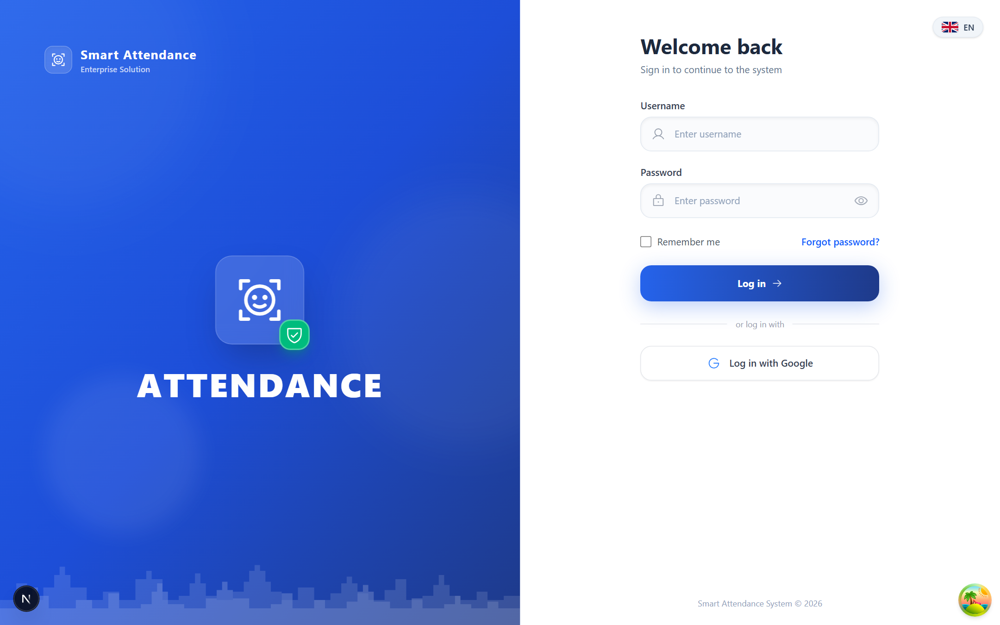

# Hi, I'm D. Quang Hung 👋

I'm a final-year **Software Engineering** student at **Eastern International University (EIU)** based in Ho Chi Minh City / Binh Duong, Vietnam.

I enjoy building complete products end-to-end — from database schemas and backend APIs in **NestJS / Prisma** to interactive web, mobile, and desktop interfaces in **Next.js, React Native, and Tauri**. Most of my recent work revolves around **TypeScript**, real-time workflows, and shipping practical software with AI-assisted engineering (`AGENTS.md` guardrails, automated testing, and scripting).

---

## Shipped Projects & What I Worked On

### 1. Smart Attendance System — EIU Capstone (Web Monorepo & Mobile App)
A three-service biometric attendance platform (**Next.js 16** frontend + **NestJS 11 / Prisma 7 / BullMQ** backend + **FastAPI / InsightFace / MiniFASNetV2** anti-spoofing service) paired with a **React Native** mobile app ([`hungdonguyen/SAS_MOBILE_FE`](https://github.com/hungdonguyen/SAS_MOBILE_FE)).

* **My role (60%+ of repository commits across Web & Mobile):**
  * Built the **Attendance Disputes** module end-to-end (database schema, role-restricted NestJS endpoints, lecturer resolution drawer, and automatic attendance status overrides when approved).
  * Built the unified **Admin Activity & Audit Logs** system tracking check-ins, biometric liveness failures, IP/device metadata, filters, and Excel/PDF report exports.
  * Replaced mock flows with real **Server-Sent Events (SSE)** live attendance updates (with polling fallback) and rewrote the English/Vietnamese (`next-intl`) localization across Admin, Lecturer, and Student portals.
  * Implemented the mobile student check-in flow using `react-native-vision-camera` and `react-native-worklets-core` (`useRunOnJS`).

  
  

  
  

  
  

---

### 2. [Educational Blackjack — Web & Desktop](https://github.com/hungdonguyen/BlackJack-Education-App)
A Blackjack training app and Monte Carlo strategy simulator built with **Next.js 16, React 19, Tailwind CSS v4, Zustand v5, Framer Motion**, and packaged as a native desktop app with **Tauri v2 (Rust)**.

* Implemented a modular rules engine (Strategy Pattern) supporting 10+ casino rulesets, real-time Hi-Lo card counting, and player edge calculation.
* Built an analytics simulator to test betting systems and measure win rate, EV per hand, max drawdown, and risk of ruin, alongside interactive guided tutorial tracks.
* Wrote Python image-processing scripts (Pillow/NumPy) to generate custom animated `.webp` card decks and automated screenshot/audio pipelines with Playwright and PowerShell.

  
  

  
  

  
  

---

### 3. [QuangHungFarm ROI — CS2 Armory Tracker & Calculator](https://github.com/hungdonguyen/QuangHungFarmROI)
A web application (**React 19, Vite, Supabase, Vercel Serverless**) that calculates real-time unboxing ROI and simulates star redemptions for CS2 Armory Passes in **VND** and **USD**.

* Implemented conditional wear probability calculations for skins with custom float caps (`min_float` to `max_float`), giving accurate expected values instead of generic wear averages.
* Built a two-layer price caching system (`localStorage` + debounced **Supabase** cloud sync) and a rate-limited request queue to avoid Steam Market API throttling.

  
  

  
  

  
  

---

## Tech Stack & Tools I Use

* **Languages:** TypeScript, JavaScript, Java, C#, Python, SQL
* **Frontend & Mobile:** Next.js (App Router), React 19, React Native (VisionCamera / Worklets), Tailwind CSS, Zustand, TanStack Query, Framer Motion, Tauri v2
* **Backend & Data:** NestJS, Prisma ORM, BullMQ (Redis), Node.js, Spring Boot, ASP.NET Core, PostgreSQL, Supabase
* **Testing, DevOps & Workflow:** Docker, Playwright, Jest, JUnit 5, Git/GitHub, AI-native development with Claude & Antigravity
